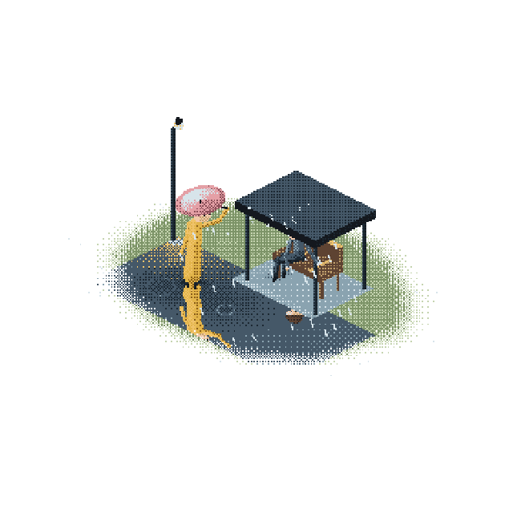
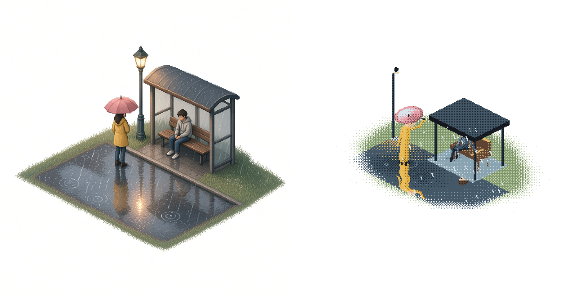
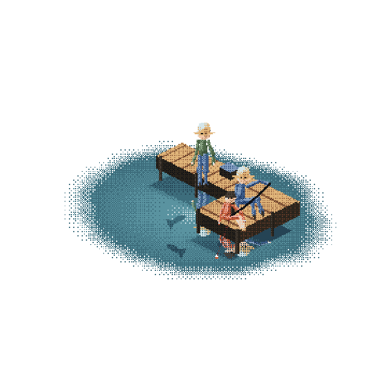
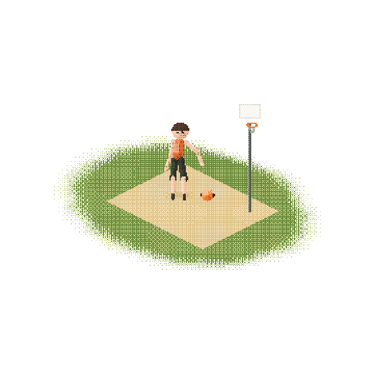
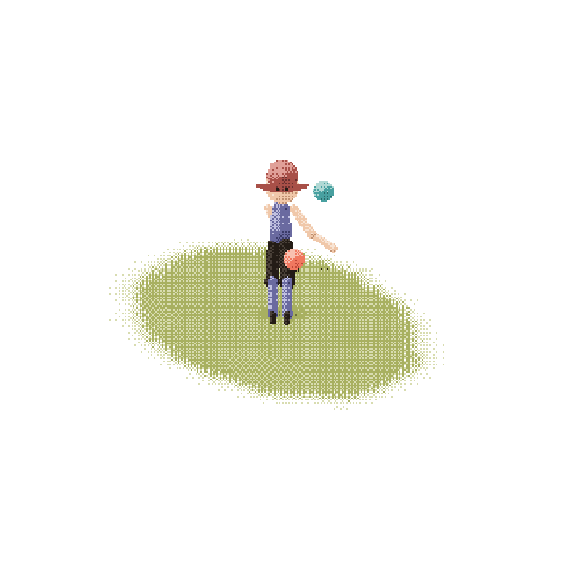

# pocketworld

A bus stop in the rain, looping, and nobody is in a hurry.



pocketworld draws small isometric worlds with **one WebGL2 shader**. Low grid, a short palette, ordered dither, twelve frames a second. The picture sits on white like a little diorama. There is no runtime dependency. You describe the scene in a JS file. The shader is generated.

[The same loop as video](docs/rain-bus-stop.mp4), if you would rather not watch a GIF.

## Thirty seconds

```bash
npm install
npm run dev
```

Open `http://127.0.0.1:8787/playground/`. Four scenes are in the menu. Every slider is a real uniform. Space pauses.

Render a frame, or the whole loop:

```bash
node cli/render.js still examples/rain-bus-stop/scene.js --time 2.4 --out frame.png
node cli/render.js gif examples/fishing/scene.js --out docs/fishing.gif
node cli/render.js compare examples/rain-bus-stop/scene.js --time 2.4 --out compare.png
```

`compare` puts the reference still next to the frame the shader just drew.

## Make your own, with your AI

The workflow an agent should follow is [`skills/pocketworld/SKILL.md`](skills/pocketworld/SKILL.md).

1. Say the scene in one sentence.
2. Fill [`skills/pocketworld/reference-prompt.md`](skills/pocketworld/reference-prompt.md) and generate a still. Or drop in a picture you already love.
3. Check it against the [spec](skills/pocketworld/spec.md). Square, white margin, 2:1 dimetric, people standing upright, a small palette. A smooth concept render is fine as a composition. The world itself gets rebuilt in pixels.
4. Save it as `examples/your-scene/reference.jpg` and write `scene.js` beside it. Named parts, named knobs.
5. Render a still, compare, then ask for the small things in plain language. "Look at him more." "Darker puddle." The skill maps those onto the knobs.

```html
<script type="module" src="/src/element.js"></script>
<pocket-world src="examples/rain-bus-stop/scene.js"></pocket-world>
```

The element pauses off screen. If the visitor prefers reduced motion, it holds the poster frame.

From JS, `mount(canvas, scene)` is the whole API. `setTime`, `setParam`, `play`, `pause`.

## How the look works

A pixel is not a blend. The shader picks a cell on a 360 grid, shades it with a number from 0 to 1, compares that number to a Bayer threshold, and only then chooses a color from a ramp of three or four stops. The dither is what softens the edge of the grass into the white. Nothing else does.

The reference is a mood. The loop is the same idea, redrawn so it can play forever.



Same camera for the others. A pier, a hoop, a juggler.





| | |
|---|---|
| Fishing pier | Thick deck, three people, a kid whose calves swing, a bite, a splash, rings. |
| Driveway hoop | One player, eight bounces, the arm in time with the ball. |
| Juggler | Three balls, a third of a cycle apart, on a small rug. |

The rain scene is the quiet one. The people barely breathe. The rain, the drips, and the puddles are the motion.

## Credits

The look owes a debt to [shawn's Small plays](https://x.com/zzzzshawn), which are also "just one webgl shader" and a dither. This repo does not include that code or those pictures.

The capsules and boxes are the usual signed-distance shapes, as written up by [Inigo Quilez](https://iquilezles.org/articles/distfunctions/).

MIT. Copyright (c) 2026 Zhenzhao Tu.
