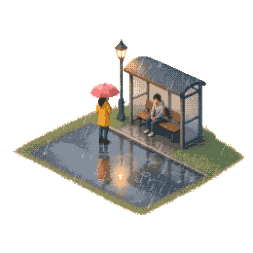
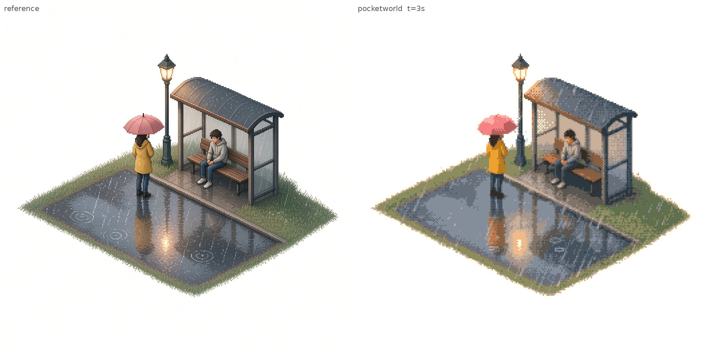
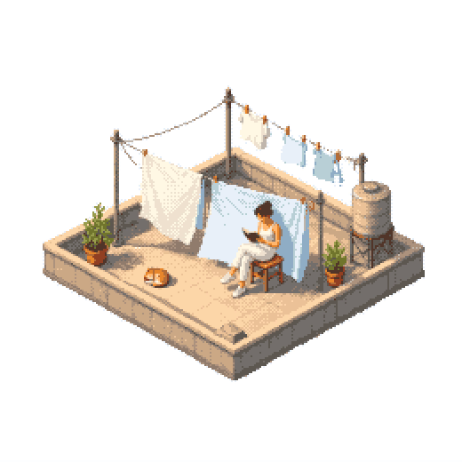
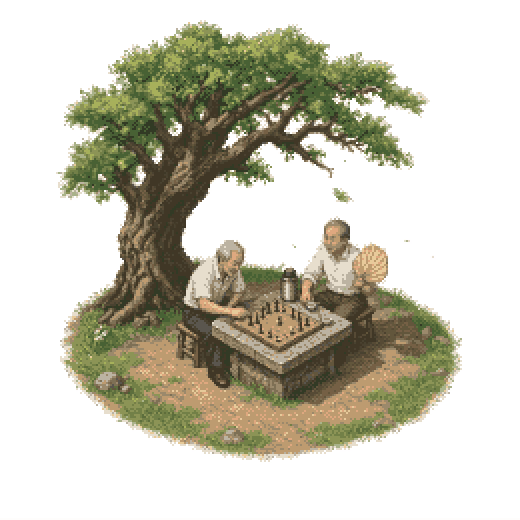
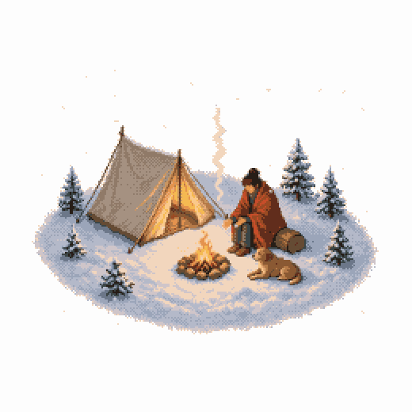
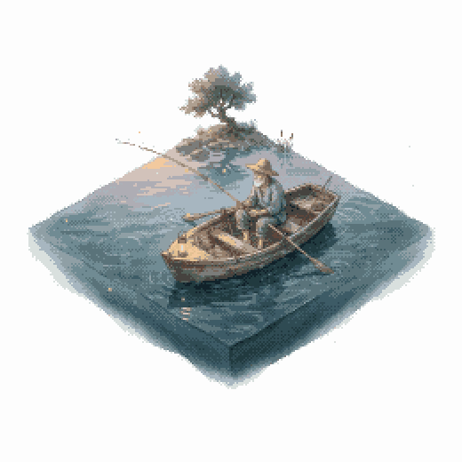

# pocketworld

A bus stop in the rain. It keeps raining.



You bring a painting. pocketworld turns it into a little diorama of stacked pixels, then lets it breathe: rain, a lamp, a sheet on a line. One WebGL2 shader, a short palette, an ordered dither, sixty frames a second, the same twelve seconds forever.

The feeling comes from [shawn (@zzzzshawn)](https://x.com/zzzzshawn) and his Small plays, which are also "just one webgl shader" and a dither. This repo does not include that code or those pictures.

[The loop as video](examples/rain-bus-stop/out/loop.mp4), if you would rather not watch a GIF.



## Laundry on the roof

The same recipe, a sunny scene. The sheets take the wind. The cat takes a breath. The woman stays where she was drawn.



[Video](examples/rooftop-laundry/out/loop.mp4). [Reference beside the frame](examples/rooftop-laundry/out/compare.png).

## Chess under the tree

The generic `layers` profile: motion is a list of layers by physical category (soft deform, rigid rotate about a pivot, path, particles, surface waves, light). The leaves sway, a few fall, and the man fans himself: the fan is cut out and rotates about his grip, riding on a small forearm swing.



[Video](examples/chess-under-tree/out/loop.mp4). [Reference beside the frame](examples/chess-under-tree/out/compare.png). [The fan at four phases](examples/chess-under-tree/out/fan_phases.png).

## Campfire in the snow

A winter campsite diorama. The campfire flames dance, warm amber light flickers across the snow and tent, the camper warms their hands, and the dog rests peacefully—its ear flicking occasionally using a rigid `duty` cycle.



[Video](examples/snow-campfire/out/loop.mp4). [Reference beside the frame](examples/snow-campfire/out/compare.png). [The ear at four phases](examples/snow-campfire/out/dog_ear_phases.png).

## Lake boat

An elderly fisherman on a calm lake at twilight. The slender bamboo rod shivers with a light bite, the water ripples gently, a warm lantern glows from the bow, the fisherman breathes, and fireflies drift through the cool evening air.



[Video](examples/lake-boat/out/loop.mp4). [Reference beside the frame](examples/lake-boat/out/compare.png). [The fishing rod at four phases](examples/lake-boat/out/fishing_rod_phases.png).

## Thirty seconds

```bash
npm ci
python3 -m venv .venv
.venv/bin/python -m pip install -r requirements.txt
export PYTHON="$PWD/.venv/bin/python"

# Optional for browser exports and live previews: install Chrome/Chromium.
# MP4 encoding uses imageio-ffmpeg's bundled binary; system ffmpeg is a fallback.
node cli/pocketworld.js doctor

# Generate an image-generation prompt or validate a reference image:
node cli/pocketworld.js prompt "a quiet bus stop in the rain at dusk"
node cli/pocketworld.js check-ref examples/rain-bus-stop

# Build and render:
node cli/pocketworld.js prep examples/rain-bus-stop
node cli/pocketworld.js render examples/rain-bus-stop
npm run dev
```

The playground is `http://127.0.0.1:8787/playground/`. `render` writes a 60 fps MP4, a GIF, a side-by-side compare, contact sheets, motion phase strips, and smoothness metrics. Node >=20 and Python >=3.10 are recommended. The browser component still requires WebGL2; CPU export does not.

## Personal agents and cloud sandboxes

Start with `doctor`. It checks Python modules, writable directories, browser launch, inline page loading, WebGL2/readPixels, a CPU frame and a short libx264 encode. `doctor --json` returns each stage, its original error and a suggestion, plus the backend this environment will select. A missing browser is reported but is not a fatal error when CPU rendering works.

```bash
export PYTHON="$PWD/.venv/bin/python"
node cli/pocketworld.js doctor --json
node cli/pocketworld.js render examples/rain-bus-stop --smoke
node cli/pocketworld.js render examples/rain-bus-stop --backend cpu

# Half-open frame ranges, 0 through 719. The second run completes and encodes.
node cli/pocketworld.js render examples/rain-bus-stop --backend cpu --frames 0:360
node cli/pocketworld.js render examples/rain-bus-stop --backend cpu --frames 360:720
```

`--backend auto` is the default: probe Chrome and readPixels, then use CPU if the probe fails. `--backend browser` requires Chrome; `--backend cpu` never starts a browser or server. CPU rendering uses NumPy arrays and the same prepared textures as WebGL. Its numeric reference is the CLI's SwiftShader software WebGL renderer, including its sine/hash approximation. SwiftShader uses fused multiply-add on the tested ARM target and separate float32 operations on the tested x86 target; the CPU backend selects that math by architecture. `POCKETWORLD_SHADER_MATH=fused|separate` overrides it for a differently configured JIT build and is included in the cache fingerprint. Arbitrary hardware GPU drivers can have different rounding.

Browser export defaults to `page.setContent()` with inline modules, manifest and PNG data URLs. It rejects all HTTP/file requests and starts no local server. `--server` retains the old localhost path for diagnosis. Configure executable paths and optional extra Chrome arguments with:

```bash
export CHROME="/path/to/chrome"
export CHROME_FLAGS="--disable-dev-shm-usage"
# Optional authoritative ffmpeg override; normally imageio-ffmpeg supplies it.
export FFMPEG_PATH="/path/to/ffmpeg"
```

An explicit `CHROME` path is authoritative, so `CHROME=/nonexistent` reliably exercises CPU fallback. Chrome launch retries use fresh temporary profiles and bounded timeouts; flags cannot grant permissions forbidden by the host.

`--smoke` captures ten frames without changing `out/`. Frame ranges also leave `out/` alone until all 720 frames are available. The cache under `build/frames/<input-hash>/` includes textures, source inputs, renderer code, backend and frame settings; changed inputs get a new cache. Corrupt PNGs are regenerated. `--force-prep` rebuilds inputs; ordinary rendering also detects changed scene/reference/prep code and newer input mtimes.

A complete run stages its new artifacts before publishing, writes `out/render.json` with the input hash and artifact hashes, and records the latest attempt in `build/last-run.json`. A failed attempt exits nonzero and does not claim the old `out/` as new output. Do not infer success merely from an existing MP4. Do not run concurrent renders of the same scene.

If neither bundled nor system ffmpeg is available, rendering still writes PNG frames, a Pillow GIF, compare/contact/phase images and frame-based metrics; it clearly reports `complete-gif-only` and does not leave an old MP4 labelled as current. `metrics.json.source` distinguishes decoded-video measurements from PNG measurements. GIFs run at 20 fps; MP4s remain 60 fps.

## Renderer verification

```bash
node cli/pocketworld.js parity  # all five examples, six times across the loop
node cli/pocketworld.js parity examples/rain-bus-stop --times 0,3
node --test tests/cli.test.js
"$PYTHON" -m unittest discover -s tests -v
# Optional UI checks when Playwright is installed (or set PLAYWRIGHT_MODULE):
node tests/browser-ui.mjs
```

Parity writes CPU/browser/difference PNGs and `parity.json` to `build/parity/` (or `--out <directory>`). The default limit is 0.02% differing cells per frame, including any RGB difference, with max and mean channel differences reported separately. Even a threshold-adjacent palette flip can have a large channel delta, so inspect the difference images too. CI checks rain and laundry and an extra fixture covering path, steam and the remaining light/particle modes. Tested dependency versions are in `requirements-test.txt`.

`prompt` creates text for an external image model; it does not call a model or automatically trace scene masks.

```html
<script type="module" src="/src/element.js"></script>
<pocket-world src="examples/rain-bus-stop/build/manifest.json"></pocket-world>
```

## Make one

The workflow is [`skills/pocketworld/SKILL.md`](skills/pocketworld/SKILL.md). The short version:

0. **Reference image (loose on content, firm on style)**: Pocketworld animates layers from a reference painting. The reference must be an isometric small diorama island on a pure white background with wide margins, low saturation, no black outlines, and clearly separated moving parts (never random street photos or cluttered edge-to-edge scenes). Generating one with an image model is the recommended path:
   ```bash
   node cli/pocketworld.js prompt "<your scene idea in any language>"
   node cli/pocketworld.js check-ref examples/your-scene/reference.jpg
   ```
   Full prompt templates and worked examples are in [`reference_prompt.md`](skills/pocketworld/reference_prompt.md).
1. Save the keeper as `examples/your-scene/reference.jpg` and a `scene.json` beside it. Trace masks on the grid from `node cli/pocketworld.js overlay examples/your-scene`. `suggest` will guess key colours and pale cloth so you are not placing every point by hand.
2. `prep`, look at the still, then `render`. The compare image and the metric tell you if it holds. The skill lists which knob fixes which problem: too painterly, too greasy, a washed-out fold, choppy time, motion that is too loud or too shy.

An earlier try drew the people out of math. They looked like math. That code is in [`experimental/sdf/`](experimental/sdf/) and it is not how these are made.

## License

MIT. Copyright (c) 2026 Zhenzhao Tu.
