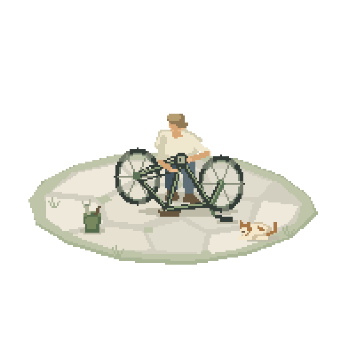
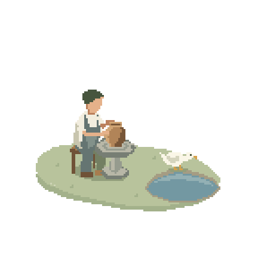

<div align="center">

# Pocketworld

### One sentence. One image. A little world of your own.

Give your agent a scene idea and a reference image. Let a tiny pixel world come to life.

[Install with your agent](INSTALL.md) · [中文](README.zh-CN.md) · [Website integration](docs/embedding.md) · [Download 0.6.0](https://github.com/Tu-Zhenzhao/pocketworld/releases/tag/v0.6.0)


*Actual Pocketworld output. Native pixel character, geometric scenery, three balls on one shared timeline.*

</div>

A quiet performer under a tree. A shepherd asleep on a buffalo. A rainy window, a garden corner, a whole small story you haven't thought of yet.

**Pocketworld is a skill for your agent.** Start with a sentence, bring or generate a reference image, and let the agent design the shapes, light and motion for their final pixel grid. Watch the scene, pause it, replay it, look closer, then decide how to take it with you.

## Give this link to your agent

```text
Install Pocketworld using:
https://raw.githubusercontent.com/Tu-Zhenzhao/pocketworld/main/INSTALL.md

Then create a pocket world: a person quietly juggling three balls
under a tree, with a wooden bench nearby.
```

The installation guide helps the agent choose its Skill directory, install the self-contained runtime, check native rendering and run a real example. It works with agents that can read files and run terminal commands. An existing reference image makes an image-generation tool optional.

## A little world, wherever you want it

| Take it as… | Put it… |
|---|---|
| **A video** | In a post, a reel, a presentation or a story |
| **A GIF** | In a README, a message or a playful corner of your page |
| **A transparent web component** | Beside your writing, inside a portfolio, on a landing page or in a little garden of your own |

The live component keeps its own timeline, supports pause/replay/seek, respects reduced-motion preferences, and sleeps when it leaves the screen. Different worlds can live together on the same page.

```html
<div id="my-pocket" style="width:480px;max-width:100%"></div>
<script type="module">
  import { mount } from './component.js';
  const world = mount(document.querySelector('#my-pocket'));
  // world.pause(); world.play(); world.seek(2); world.replay();
</script>
```

Download a generated component and host it with your page. See [embedding](docs/embedding.md) for exact files, multiple scenes and CSP. JavaScript-capable pages can use the live component; other surfaces can use the GIF or video. MP4 is opaque; GIF uses binary transparency at 20fps; the web component preserves true alpha, including white objects.

## Try a different small story

### Made with Pocketworld

Two quiet scenes to watch, take apart, and make your own. Both include the finished animation, review player and editable source.

| Afternoon bicycle repair | Pottery by the pond |
|:---:|:---:|
|  |  |
| A turn of the pedal. A wheel slowly coming to rest. A breathing cat and a passing breeze. | Hands following the clay. A duck drinking, swallowing, and taking its time. |
| [60 fps video](examples/bicycle/loop.mp4) · [Review player](examples/bicycle/index.html) · [Editable source](skills/pocketworld/assets/examples/bicycle) | [60 fps video](examples/pottery/loop.mp4) · [Review player](examples/pottery/index.html) · [Editable source](skills/pocketworld/assets/examples/pottery) |

Serve the repository locally to open the players. The GIFs play here on GitHub; the videos show the subtler timing. [Sample guide](docs/samples.md) · [Use the bicycle on your website](docs/embedding.md#use-the-bicycle-sample). These are finished examples refined through art direction, not one-shot guarantees.

> A tiny summer stall. The fan turns; a curtain catches the breeze.

> A buffalo chewing grass while a shepherd sleeps on its back, breathing slowly.

> A little courtyard where someone practices a basketball shot, catches it, and tries again.

Your scene can be a person, an animal, an object, a place or a small interaction. Give the agent a mood, a reference, and one action to care about. Make something for a page header, a loading state, a journal, a desktop corner—or a place we haven't imagined.

## Built for the pixels

- Shapes are designed at the target grid, with deliberate silhouettes and connected details.
- Hands, props, shadows and responses follow shared scene state.
- Art guidance covers people, animals, structures, plants, water and light.
- The review player includes playback, scrubbing, detail crops and synchronized alternatives.

The agent authors and refines the scene. Complex anatomy and choreography can take more iterations; this is not an automatic reconstruction service for arbitrary photographs.

## Native worlds, even without Chrome

Native CPU export works in browser-restricted agent environments, covering standard geometry and all shipped examples. The same authored shapes and motion produce the poster, video, GIF and component package. Use `--backend cpu` without Chrome. If a cloud computer's localhost is unreachable, the agent can still send real images, video/GIF and a review package. Local users keep the full interactive player. See [runtime support](skills/pocketworld/references/runtime.md).

## Fewer cells, more intention — 0.6

Start with what makes the scene recognizable: its silhouette, spacing, supports and action. The new [annotated studies](skills/pocketworld/references/art-studies.md) show fine, deliberately simplified and over-coarse versions; real construction stages; and a moving neck that needed a structural repair. Choose feature budgets before canvas size. A browser-free study helper saves exact native frames and detail crops before polishing.

Pottery and bicycle repair are runnable samples alongside the three-ball juggler and resting ox. The direct-cell starter complements geometric volume; both use the same player and exports. These tools help the agent inspect its work; they do not replace artistic judgment or reconstruct arbitrary photographs automatically.

## Run the example yourself

```sh
git clone --depth 1 --branch v0.6.0 https://github.com/Tu-Zhenzhao/pocketworld.git
cd pocketworld
npm ci
npm run demo
```

Open the printed local URL. The checked-in example plays directly in a WebGL2 browser. To create fresh exports, run `npm run setup`, then follow [authoring](docs/authoring.md). Node20+ is required for tooling; ffmpeg is needed only for video/GIF encoding. No Python or model API key is required by the scene runtime.

[Agent installation](INSTALL.md) · [Authoring](docs/authoring.md) · [Embedding](docs/embedding.md) · [Troubleshooting](docs/troubleshooting.md) · [Contributing & verification](CONTRIBUTING.md) · [Migration from 0.3](docs/migration.md)

Inspired by the feeling of Shawn's small pixel worlds. The included code and example renders are our own; no artist footage or unpublished source is distributed.

MIT · Zhenzhao Tu
