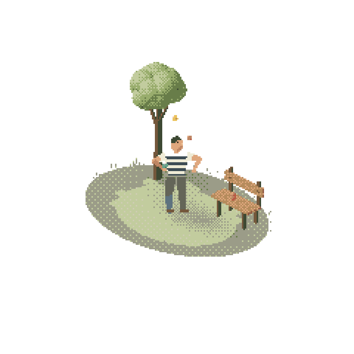

<div align="center">

# Pocketworld

### 一句话，一张图，长出一个口袋世界。

把一个小念头交给你的 Agent，让它在像素里生活起来。

[让 Agent 安装](INSTALL.md) · [English](README.md) · [嵌入网页](docs/embedding.md) · [下载 0.5.1](https://github.com/Tu-Zhenzhao/pocketworld/releases/tag/v0.5.1)



*真实生成结果：原生像素角色、几何环境，三个球与双手共享同一条动作时间线。*

</div>

树下练习抛球的人，牛背上午睡的牧童，夏日轻轻转动的风扇。也可以是你此刻想到的另一个小故事。

**Pocketworld 是给 Agent 使用的 Skill。** 你描述场景，提供或生成一张参考图，Agent 会按照像素网格重新设计形状、光照和动作。先在播放器里看、暂停、重播、拖动和细看，再决定怎样交付。

## 把这一段交给你的 Agent

```text
请按照这个公开链接安装 Pocketworld：
https://raw.githubusercontent.com/Tu-Zhenzhao/pocketworld/main/INSTALL.md

安装好后，做一个小世界：一个人在树下轻轻抛三个球，旁边有一张木长椅。
```

安装入口会指导 Agent 确认宿主的 Skill 目录、准备运行环境、验证原生 CPU 渲染，并真正跑一遍示例。Agent 需要能够读写文件、运行终端命令；你已有参考图时，不必另外具备生图工具。

## 让它出现在你想要的地方

- **视频**：放进动态、演示或短片。
- **GIF**：放进 README、消息和网页的小角落。
- **透明网页组件**：住进博客侧栏、个人主页、作品集、页头，或你自己的数字花园。

网页组件保留真实透明背景，白色衣服也不会被抠掉；可以暂停、重播、跳到某个时刻，离开屏幕后自动休息。同一张网页可以放多个不同的小世界。

```html
<div id="my-pocket" style="width:480px;max-width:100%"></div>
<script type="module">
  import { mount } from './component.js';
  const world = mount(document.querySelector('#my-pocket'));
  // world.pause(); world.play(); world.seek(2); world.replay();
</script>
```

下载生成的组件并与你的网站一起托管。支持脚本和自定义元素的网页可以嵌入实时组件；其他地方可以用 GIF 或视频。[集成说明](docs/embedding.md)写明了文件、多个场景与 CSP 的用法。MP4 是不透明背景；GIF 为20fps、二值透明；网页组件保留原生实时动画和透明度。

## 发挥想象力

> 夏日小摊，风扇慢慢转，布帘偶尔被风掀起。

> 草地上的牛嚼着草，背上的牧童盖着草帽，肚皮缓缓起伏。

> 一个小小篮球场，投篮、接球，再来一次。

人、动物、器物、植物，或一个很小的互动，都可以成为主角。你可以用它装点日记、博客、加载界面，或者干脆做一个只属于自己的角落。

## 先让像素讲清楚故事

Pocketworld 按目标网格设计轮廓、色块和细线；让手与道具、光与影、接触与反馈有共同的来由。Skill 自带分类美术规则、可运行示例，以及统一的展示和交付界面。

实际制作由 Agent 完成。复杂动物造型和动作编排仍可能需要多轮打磨；它并不承诺把任意照片一键自动重建。

## 自己运行示例

```sh
git clone --depth 1 --branch v0.5.1 https://github.com/Tu-Zhenzhao/pocketworld.git
cd pocketworld
npm ci
npm run demo
```

打开打印出的本地地址。仓库自带可直接播放的成品示例；制作新输出时，先运行 `npm run setup`，再读[制作说明](docs/authoring.md)。工具需要 Node20+；仅导出视频/GIF 时需要 ffmpeg。场景运行不需要 Python 或模型 API Key。

[Agent 安装](INSTALL.md) · [美术与制作](docs/authoring.md) · [网页组件](docs/embedding.md) · [排错](docs/troubleshooting.md) · [验证与贡献](CONTRIBUTING.md)

灵感来自 Shawn 的像素小世界。随包代码和示例渲染均由本项目自行制作，不包含原作者的视频或未公开源码。

MIT · Zhenzhao Tu

## 0.5：受限环境也能制作原生世界

新增原生 CPU 导出：直接绘制场景几何与像素形状，保留现有美术与交付 UI。受限宿主使用 `--backend cpu`，不启动 Chrome；`auto` 支持浏览器失败后转 CPU。标准几何、抛球和牛背示例均支持。自定义 WebGL 需要适配器，详见[运行能力](skills/pocketworld/references/runtime.md)。生成参考图前先查看极简风格锚点，用户自由描述场景，视觉语言保持克制与留白。
