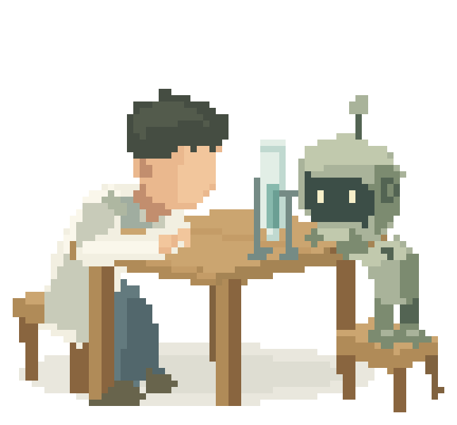

# One bubble / 一颗气泡

Made with Pocketworld.

用 Pocketworld 制作。

A person in a lab coat and a small robot lean over a table, watching a bubble rise in a test tube.

一个人穿着实验袍，和一只小机器人一起趴在桌边，看试管里的气泡升上去。

## Rendered showcase / 渲染展示

This folder is a rendered showcase without runnable source. The finished animation is here to watch and share. The scene source was not kept, so this directory has no player, scene file, or regenerate step.

这里只放已经渲染好的成片，没有可运行的源码。可以观看，也可以分享。场景源码没有留存，因此没有播放器、场景文件，也不能从这里重新导出。

`examples/` holds runnable reviews and editable scenes. This showcase stays outside that directory.

`examples/` 放的是可运行的播放器和可编辑场景。这个展示单独放在外面。

## Files / 文件

| File | Contents |
|---|---|
| [loop.gif](loop.gif) | Animated GIF for GitHub and README. 648×603, nearest-neighbor, sampled at 20 fps from the 12-second loop, binary transparency, loops forever. |
| [one-bubble.webp](one-bubble.webp) | Original animated WebP. 1312×1220, 624 frames, 12 seconds, loops forever. |
| [poster.png](poster.png) | Still poster of the opening frame, 1312×1220. |

GIF 供 GitHub 和 README 自动播放。WebP 是原始成片。海报是开头那一帧的静帧。
