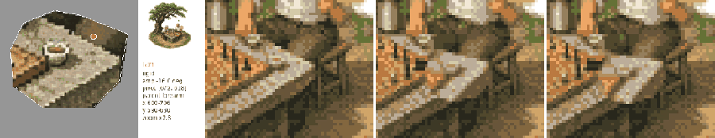
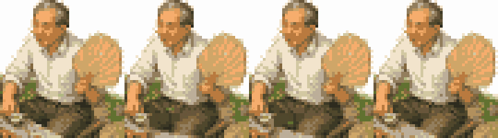
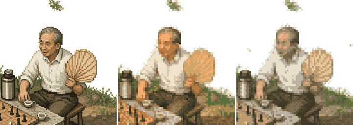
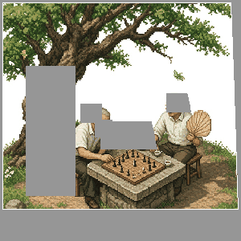

# Common failures

Check every render against this table. Each image is the real failure.

| symptom | cause | fix | evidence |
|---|---|---|---|
| The table corner and teacup swing; the fan stays put | `fan` poly was placed on the table, not the fan. Coordinates were guessed, never drawn on the overlay. | Draw the poly on `overlay --step 32`. Open `build/parts.png`; the tile must BE the fan + hand. |  |
| The fan looks frozen | amp too small for the part's reach (sweep < 2 cells at the tip) | Fan or handheld prop ≥12° about the grip (15–25°). Check `<part>_phases.png`. |  |
| Candy colours, orange skin, greasy blocks (left: reference, middle: sat 1.15 / chroma 1.1, right: 0.92 / 0.96) | `saturation` / `chroma` raised above 1.0 | Keep both 0.9–1.0. Fix muddy tones with `keyColours`. |  |
| People are frozen and the canopy tears around them (grey boxes = `still`) | Whole figures put in `still` | `still` only for eyes, facial detail and small precise things. Faces go in `detail`. Add a breath layer. |  |
| White specks inside dark foliage or trunk | Paper-white gaps in the reference survive the coverage test, and the soft warp drags them into the dark area | `covBlur` near 1, `haze` 0.3. Tighten the soft poly off the paper edge. Check zoomed crops. |  |
| A blurred ghost or halo where a rigid part was at rest | poly too tight (part ink left behind), or amp too big for the diffusion fill | Grow the poly a few px around the part. Lower amp. Check the phase strip at peak. | — |
