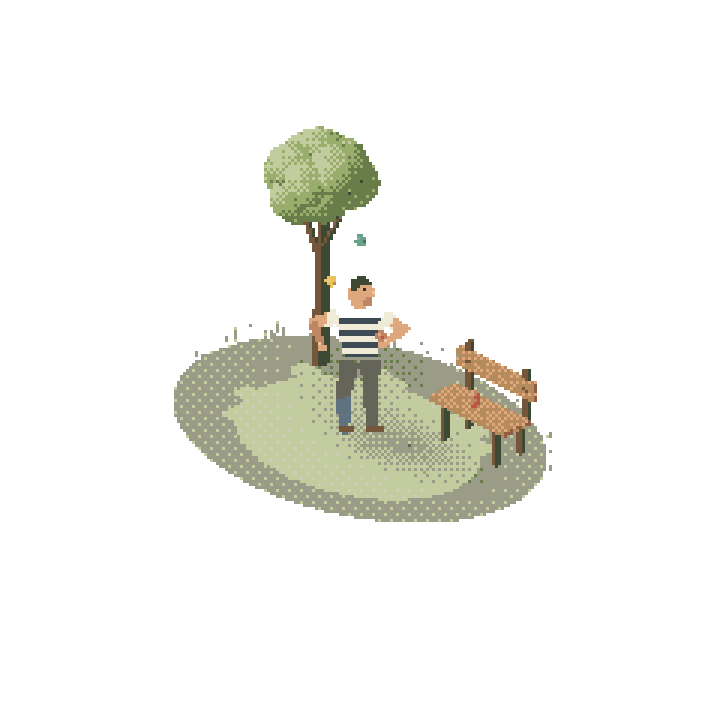
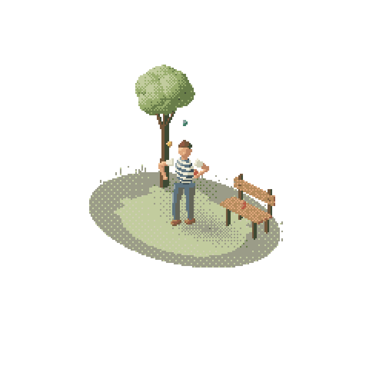

# Art direction contract

For native authoring. Numerical ranges are useful design starting points; adapt them to the story.

## Camera and composition

Start with orthographic projection, azimuth 45°/elevation 30°: ground axes project 2:1. True isometric elevation is different. Keep the chosen projection and key light across alternatives.

Fit the full action envelope, including horns, poles, ball apex and shadow, within white margins. Content around 60–85% canvas width and 35–60% height is a useful starting range, not a universal crop. A person and a court can share visual framing with different world-unit scales. Name camera span/target and subject cell dimensions; do not force one physical camera distance for every subject.

Choose footprint by story: planar court, pier strip, oval performer stage, irregular fading meadow. Avoid making every world a rectangular block. Keep horizon/sky absent unless requested. Transparency should preserve intended silhouette and empty margins.

## Short style contract

State hero, primary action, recognizable silhouette cues, footprint, camera, subject cell sizes, light, major value groups, material ramps, outline policy and fixed contacts. For characters, state head/body/hand sizes in cells: whole-canvas resolution is not a substitute. Simplify a face or reframe if its budget cannot carry the proposed detail.

Select those feature budgets before choosing the whole grid. View the [annotated budget comparison](art-studies.md); neither 144 nor 288 is a global quality target. When a hand/rim/animal cannot read, revise contour, negative space, overlap, local pose and value separation before adding cells. State the specific remaining information loss before raising a budget.

## Shape hierarchy

1. At native/thumbnail size identify actor, animal, prop and action without texture.
2. Test a solid silhouette: species/posture, arm/leg/horn gaps and meaningful overlaps.
3. Establish continuous light/middle/shadow clusters. Clean flat planes are useful; a failed painting-posterize experiment is not a ban on designed flat colors.
4. Add only purposeful tiny marks: eye, brim, grip, hoof, seam. Remove uninformative speckles.

Native geometry still needs authored anatomy. A stack of spheres is not automatically a believable animal. Do not solve a bad silhouette by adding dither or resolution.

## Material/light decisions

Use ordered material ramps, often 3–5 useful tones, sharing actual colors when suitable. Separate neighboring skin/cloth/background. Keep hero features quieter than water/foliage. Structural dark cells are allowed for eyes, frame tubes and board gaps; avoid thick uniform comic outlines unless intended.

One coherent key light and stable contact shadows explain volume/support. Dither locally for controlled transitions, water, leaves and coverage fringe; retain large quiet areas. Anchor texture deterministically so static surfaces do not boil.

## Inspect and refine

Inspect 1× cells, final presentation size and integer-enlarged hero crops. Record what is recognizable, what is wrong and what changed. A good reference is not proof the implementation is correct.

For motion identify support, moving volume, constraints and response. Smaller amplitude cannot repair an anatomically wrong deformation. Floating bodies, isolated belly patches, stretching limbs, sliding feet and disconnected lines require structural fixes.

Inspect actual native coverage through the extreme, not just endpoint coordinates: thin necks, wrists and rims can pinch apart during rasterization. Test overlapping connected volumes/segments and nearby occluders. Keep continuous state for natural timing; do not round every motion variable just because the final coverage occupies integer cells.

The shipped juggler and redesigned ox scene demonstrate two subjects and rendering approaches. Use them as direction for composition and deliberate clusters; new anatomy, framing and action still need their own visual review.

## Keep style stable across stories

Before authoring, save a short `ART_DIRECTION.md` with the scene: camera/span/target, hero dimensions in cells, 3–5 identity cues, negative spaces, silhouette and light/middle/shadow thumbnails, shared palette ramps, fixed contacts, primary action and secondary motion. Include which study was visually approved and which qualities are being reused. Lock this contract while evaluating variants; change one significant aesthetic variable at a time. A camera/world-scale adjustment is allowed to preserve comparable apparent size.

Review three levels separately: **identity** (what/pose/action is immediately understood), **drawing** (silhouette/planes/connected one-cell features), **motion** (support/deformation/causal response). Do not trade a failed identity for attractive texture, or treat technical export success as art approval. Record pass/revise/uncertain with concrete evidence. If two structural revisions still leave the species or posture unclear, change the relevant reference or blockout rather than add polish. Keep the approved intermediate still when continuing animation work.

## Included visual anchors

These are our own hand-authored study renders, not frames from Shawn's videos. Both show the intended quiet visual feeling. They are 720px presentations of a 240-cell frame (nearest ×3). Use them for quiet framing, deliberate character clusters, meaningful gaps and restrained volume; they do not establish correct anatomy for every new subject.

