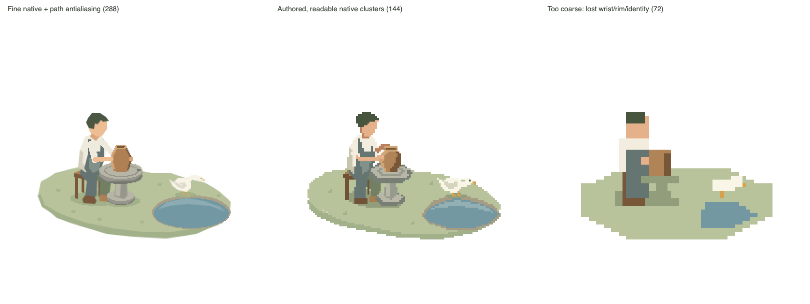
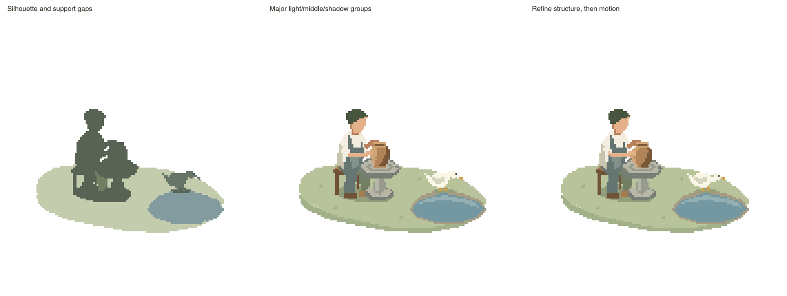
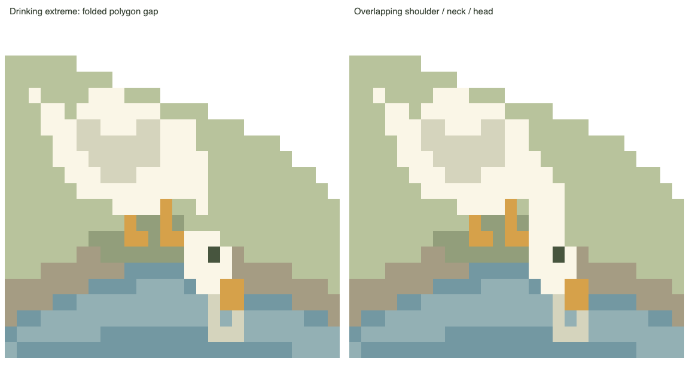
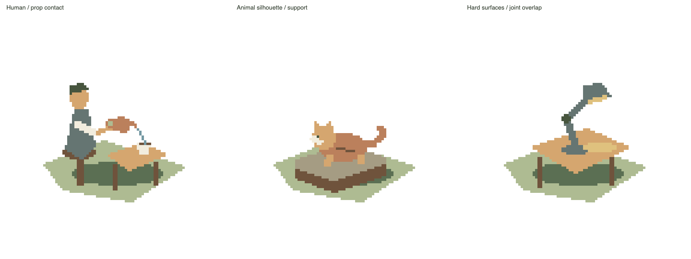

# Learn the decisions, then make a new world

Use only the relevant study before creating a scene. These are our own authored renders and source, not frames from another artist. The pottery direction was approved by the user; that approval does not automatically approve every exercise or new scene.

## Same story, different information budgets

View this actual image with the host image-view tool; a Markdown link alone is not evidence of looking:



- Left: a native 288-cell scene with a fine feature budget and Canvas path antialiasing. It is not a photograph made into a mosaic, yet still feels too soft/fine for this target.
- Middle: the 144-cell design uses a clear wrist, open rim, broad belly/side shadow, duck direction and grounded supports. This is a scene-specific choice, not a new universal grid.
- Right: hard edges and fewer cells alone lose the wrist, opening and animal identity. Do not optimize for minimum grid/color count.

Panels use equal integer-scaled presentation dimensions and comparable composition. The first comparison changes several variables. To isolate just edge coverage, inspect [the same triangle with path fill and direct cells](../assets/art-studies/pottery/renders/edge-coverage.png). `imageSmoothingEnabled=false` affects image resampling, not the Canvas path rasterizer. The pixel starter uses `PixelPen` to write covered cells directly.

## Preserve actual construction stages



The runnable `assets/art-studies/pottery/silhouette/` and `planes/` preserve actual source stages from the experiment; `assets/examples/pottery/` is the corrected final scene. They are not filters applied to a finished raster. At the first stage ask whether posture, species and support gaps read. At the next ask whether neighboring planes separate the hand, pot and body. Add texture only when it carries useful material/volume information.

For a new input, record briefly: what story/contacts must survive; what can be omitted/reframed; identity cues and gaps; key feature sizes in cells; what actual still changed your decision. A supplied photo guides this analysis rather than requiring every surface detail to be copied. Preserve user-locked composition/style.

## A still can hide a broken moving silhouette



At maximum dip the original neck polygon folded into a narrow pinch and left a missing row. The repaired scene overlaps shoulder, neck segments and head at native coverage. The feet never moved; coordinate targets and an attractive rest pose were insufficient.

Run this scene-specific check after generating the pottery review:

```sh
node SKILL_ROOT/assets/art-studies/pottery/checks.mjs /absolute/pottery-review
```

It checks all 721 states, actual shoulder-to-eye cell connectivity, ripple timing and endpoint. The mask deliberately excludes orange feet/beak: otherwise a foot beside a detached head can create a false bridge. It rejects the preserved `neck-gap/` counterexample. These coordinates are for pottery only. For another story author equivalent checks from its own supports, grips, geometry and events; do not apply a duck rig/mask universally. Connectivity does not certify anatomy, causality or elegance. Also inspect the extreme and its neighbors; keep remaining weaknesses explicit.

## Browser-free inspection

```sh
node SKILL_ROOT/scripts/study.mjs /absolute/scene --out /absolute/new-study \
  --times 0,2.3,2.3166667,2.6,12 --scale 4 --backend cpu
```

The times above are illustrative seconds within a 12-second loop. Choose this scene's rest/contact/release/extremes and adjacent frames. `--variant id` selects an actual alternative. The helper reuses the normal adapter, saves native PNGs, exact integer enlargements and `delivery.json.focus` crops from the same frame, plus `study.json`, source hashes and a local `study.html` gallery. No browser/socket is needed to sample. Default five times are not a full-loop check. Use fresh output directories.

Statistics report coverage, alpha and visible colors, never an art score. Partial alpha may be intentional for a shadow; fully opaque blended colors may still come from antialiasing. Study sampling failure is reported in `study-failure.json` and exits nonzero; a generated poster does not mean inspection passed. Keep numeric checks and visual findings separate.

On a cloud host inspect PNGs directly and attach the result/media/package to the conversation. Its localhost may be invisible to the user's browser. On a local host serve the generated review; preserve the full player, replay/scrub/crops/background/format choices. Do not remove the player to accommodate cloud delivery.

## Transfer, without copying a scene inventory



`assets/art-studies/transfer/` has real `tea`, `cat`, `lamp` variants. They exercise wrist/spout/cup alignment, species/support cues and connected constructed planes. They are authored exercises, not evidence that every agent or arbitrary image generalizes. Try a new subject with the same process, explain its particular decisions, and compare the actual result. Do not copy pottery props or a human rig into every story.

Source provenance and approval boundaries: [asset record](../assets/art-studies/PROVENANCE.json). Repository developers can regenerate the plates with `npm run studies`.
